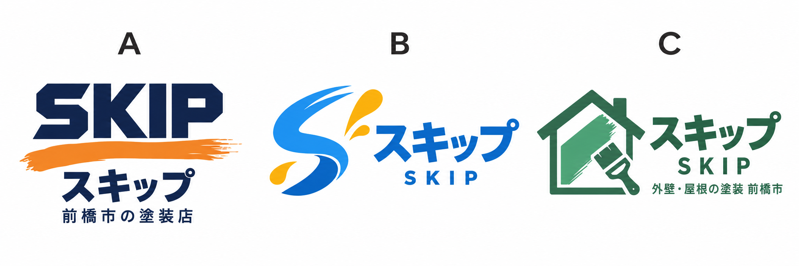
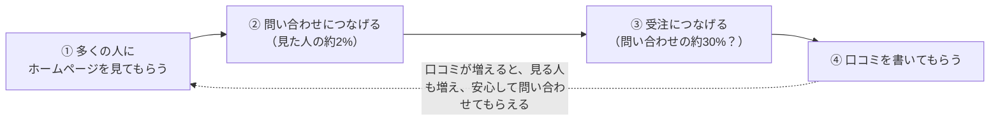

# skip-painting-site

前橋市の塗装店「スキップ」（細谷さん）のホームページ制作用リポジトリです。

## 目的とコンセプト

- 最優先の目的は、電話とフォームでの問い合わせを増やすことです。
- 小規模な塗装店で、施工実績の数が少なく、更新も年に数回の想定のため、複数ページのサイトではなく1ページのLPから始めました。
- キャッチコピーは「群馬の家を、塗り替える。」です。県内全域に向けた入口にしつつ、タイトル、説明文、会社情報に「前橋市」を残して、地域名での検索にも対応します。
- 事例が増えたら、LPを残したまま事例ページだけ追加できます。

## つくり方の方針

### 静的サイトで作る

- HTML、CSS、JavaScriptだけの静的サイトです。サーバー側のプログラム、データベース、CMS（WordPressなど）を使いません。そのぶん、保守の手間が少なく、壊れにくい作りです。
- HTML、CSS、JavaScriptの合計は約90KBです（フォントを除く）。外部のライブラリを使わず、軽く作っています。
- 更新は、ファイルの差し替えだけで済みます。

### 検索対策（SEO）

実施済みの内容です。

- ページの見出し（h1）を1つにして、h2、h3の階層を整理しています。
- タイトルと説明文に、「前橋市」「群馬」「塗装」を自然に含めています。
- スマホ表示に対応しています。画面の幅に合わせてレイアウトが切り替わります。
- 工程、塗料、色選び、見積書の見方、よくある質問を、画像ではなく文章で書いています。
- よくある質問は、構造化データ（JSON-LD）としても入れています。検索エンジンやAIが、内容を読み取りやすくするためです。

公開前に行う内容です。

- 確認用の `noindex`（検索結果に出さない指定）を、`index.html` の `<head>` から外します。
- 電話番号、所在地、営業時間を実際のものに差し替えたうえで、事業者情報の構造化データ（LocalBusiness）を追加します。仮の番号のまま入れると、誤った情報が検索に出るため、後回しにしています。
- Googleビジネスプロフィール（マップ表示）を登録します。ページの事業者情報と、同じ内容にそろえます。
- `sitemap.xml`、正規URL（canonical）、SNS用の画像（OGP画像）を、ドメインが決まってから追加します。
- 写真が入ったら、画像の代替テキスト（alt）を日本語で付けます。
- 施工事例を、地域、工事内容、期間を文字で書いて増やします。

限界もあります。検索順位は保証できません。1ページのLPは、ページ数の多いサイトより、検索では不利です。Googleビジネスプロフィールと、名刺・チラシのQRコードの併用を前提にしています。

### AI検索対策

AI検索（ChatGPT、Gemini、Google AIによる概要など）に、内容が引用されやすい書き方にしています。

- 結論を先に書き、短い文でまとめています。
- よくある質問を、質問と答えの形で書いています。
- 「塗装の工程」「塗料の種類」「見積書の見方」のように、専門知識を、具体的な文章で載せています。
- `robots.txt` で、検索やAIのクローラーを制限していません（現在は `noindex` を入れているため、公開前は検索に出ません）。

公開前に行う内容です。

- 屋号、所在地、電話番号、営業時間、対応エリアを、サイト、Googleビジネスプロフィール、名刺で同じ表記にそろえます。
- ページに更新日を明記します。
- AI向けのサイト説明ファイル（`llms.txt`）の追加は、任意です。現時点で、AI検索に効果があるかは未確認です。

AI検索での表示や引用を、保証するものではありません。

### セキュリティ

静的サイトなので、攻撃を受ける入口を小さくしています。

- サーバー側のプログラム、データベース、管理画面がありません。WordPressのプラグインの脆弱性のような、サーバー側の問題の影響を受けません。
- 外部のJavaScriptライブラリ、広告、解析タグを読み込んでいません。外部から読み込むのは、Googleフォントだけです。
- `_headers` に、セキュリティヘッダーを設定しています。
  - スクリプトは、同じサイトのファイルだけを許可しています（CSP）。CSSとJavaScriptは、HTMLに埋め込まず、別ファイルに分けています。
  - ファイル形式の誤判定の防止（`X-Content-Type-Options`）、他サイトの枠への埋め込み禁止（`frame-ancestors`、`X-Frame-Options`）、リファラの制限、カメラ・マイク・位置情報の無効化も入れています。
  - 手元で、この設定をかけた状態で配信し、スライダー、工程の切り替え、色の選択、よくある質問の開閉が動くこと、設定違反のエラーが出ないことを確認しています。
  - `_headers` は、CloudflareとNetlifyの形式です。別の公開先では、設定方法が異なります。
  - 例外として、画面の見た目を指定する `style` 属性だけは、インラインを許可しています。
- 通信の暗号化（SSL）を導入します。説明と手順は、次の「SSL」の節に書いています。
- お問い合わせフォームは、個人情報をこのサイトに保存しない形にする予定です。外部のフォームサービスで受け取り、受け取り方が決まったら、CSPの許可先も更新します。現在のフォームは、見た目だけで、送信されません。

「穴がない」とは言い切れません。静的サイトでも、次のような問題は残ります。

- 公開先やGitHubのアカウントの乗っ取り
- 外部サービス（フォーム、フォント）側の問題

対策として、各アカウントに二要素認証を設定し、外部サービスを最小限にします。

### SSL（通信の暗号化）

**SSLとは。** ホームページと、お客様のスマホやパソコンとの間の通信を、暗号にして守る仕組みです。正式な名前は「TLS」ですが、一般にはSSLと呼ばれています。使われていると、ホームページの住所が `https://` で始まり、ブラウザに鍵のマークが出ます。

**なぜ必要か。**

1. **お客様の情報を守るため。** フォームに入れた名前と電話番号が、途中でのぞき見られたり、書き換えられたりするのを防ぎます。暗号になっていないと、特に、お店の外のWi-Fi（カフェ、公共のWi-Fi）では、見られる危険があります。
2. **警告でお客様を逃さないため。** SSLがないと、ブラウザが「保護されていない通信」と表示します。お客様が不安になり、申し込む前に離れてしまいます。
3. **検索の面でも有利になるため。** Googleは、`https://` で通信しているかを、検索の評価の目安の1つにしています。ただし、順位が上がることを保証するものではありません。

注意点として、鍵のマークは「お店が本物である」ことの証明ではありません。「お客様とホームページの間の通信が守られている」という意味です。お店が本物かどうかは、会社情報、施工事例、電話番号の表記で伝えます。

**導入すること。** このホームページには、SSLを導入します。

- 公開先が、SSLの証明書を、自動で発行・更新する仕組みを使う予定です。ドメインを公開先につないだ時点で、有効にします。選んだ公開先で自動発行されるかは、公開時に確認します（未確認）。
- 公開時に、次の3点を確認します。
  1. `https://` で、ホームページが開く
  2. `http://` で開いたときに、自動で `https://` に切り替わる
  3. ブラウザに警告が出ない
- 3点を確認してから、`_headers` に、「このサイトには、必ず `https://` で接続する」という指定（HSTS）を追加します。先に入れると、SSLに問題があったときに、お客様が開けなくなる場合があるためです。
- 現在のLPは、SSLを前提に作っています。外部から読み込むGoogleフォントも、`https://` です。

## ロゴ案

GPTで作った3案を比較し、仮で案Aを採用しています。3案を並べた画像は `docs/logo-proposals-3.png` です。

### 案A：シンプル信頼型（仮採用）

- 太いゴシックの「SKIP」の下に、刷毛で引いたようなオレンジの線を入れ、その下に「スキップ」「前橋市の塗装店」を添えた縦積みのロゴです。
- 色は紺（`#14284B`）とオレンジ（`#F28C28`）の2色です。
- 採用の理由は次の3点です。
  - 屋号がすぐ読めて、刷毛の線と「前橋市の塗装店」で塗装屋だと伝わる
  - 名刺、車のマグネット、作業着、看板、LPのヘッダーに展開しやすい
  - 小さくしても、太い「SKIP」の文字が潰れない
- 弱点は、「前橋市の塗装店」が小さく、名刺や車では読みにくくなる場合があることと、縦積みなので横長版を別に用意する必要があることです。

### 案B：スキップする動き型

- 頭文字「S」を、跳ねるような青い曲線で描いたシンボルマークです。黄色のペンキのしずくを添え、横に「スキップ」「SKIP」を置いています。
- 色は明るい青、濃い青、差し色の黄です。
- 親しみやすく、覚えてもらいやすい反面、画像のどこにも「塗装」が出ておらず、初見では何の店か伝わりません。Sのスウッシュ形は他業種にも多く、似たロゴが出てくる可能性も高めです。

### 案C：家＋刷毛型

- 家の輪郭のなかに、斜めの刷毛ストロークで塗りかけの壁を描いたマークです。横に「スキップ」「SKIP」「外壁・屋根の塗装 前橋市」を置いています。
- 色は深い緑と明るい緑の2色です。
- 塗装屋だと一番早く伝わります。ただし、家と刷毛の組み合わせは同業に多く、埋もれやすいです。刷毛の細部は、名刺サイズや作業着の刺繡では潰れやすくなります。

### 案Aの書き出しファイル

- GPTの画像をもとに、SVGで描き直したものを `logo/` に置いています。縦積み版、横長版（LPヘッダー用）、正方形のアイコン版（ファビコン、SNS用）の3種です。
- 文字はアウトライン化しているため、フォントがなくても同じ形で表示されます。
- 使い始める前に、前橋周辺の同業に似たロゴがないか、検索で確認してください。
- 細谷さんが正式に案を選ぶまでは、「仮採用」の扱いです。

## 制作の基準

次の基準で作っています。最終的な確認は、`docs/confirm-list.md` の項目を含めて行います。

- 最優先は問い合わせです。電話とフォームのボタンには、押したあとに起こることを書いています。
- 画面の文言は、固有名詞を除いて日本語です。英字だけの飾り見出しは使っていません。
- 本文は、スマホでも16px以上です（図の中の文字も、実際の表示で16px以上になるよう調整済み）。
- グラデーション、3枚並びのカード、大きな角丸は使っていません。表はスマホで縦に積み、横スクロールをなくしています。
- 写真は仮の枠で、画面に「仮」と書いています。実在しない実績、顧客名、口コミは載せていません。
- フォームには、送信前に個人情報の利用目的を表示し、同意のチェックを必須にしています。プライバシーポリシーの雛形をページ内に置いています。
- キーボード操作、フォーカス表示、代替テキスト（日本語）、「視差効果を減らす」設定に対応しています。
- 確認が取れていない記述は、`docs/confirm-list.md` で管理しています。

検証の結果（20261030、ローカルで `_headers` のセキュリティヘッダーをかけた状態）：375px、768px、1440pxで、横スクロール、16px未満の文字、はみ出しがないことを確認しました。ページ内リンク、症状・工程・色の選択、よくある質問の開閉、スライダーのキー操作、フォームの入力チェックも、実際に操作して確認しました。サイト側のエラーはありません。なお、検証環境からはGoogleフォントに接続できず、その読み込みエラーだけは出ています（フォントが読めない場合は、代わりの日本語フォントで表示されます）。

## LPの構成

上から次の順です。

1. ヘッダー（ロゴ、電話番号）
2. ファーストビュー（キャッチコピー、塗る前と後の比較、電話とフォームへのボタン）
3. 症状から探す（5つの症状を選ぶと、塗り替えの目安を表示）
4. スキップが選ばれる理由（3点）
5. 施工事例（ビフォーアフター写真の枠）
6. 対応している工事
7. 塗装の工程（7つの工程を選ぶと、壁の断面図が変わる）
8. 塗料の種類（5種類の比較表）
9. 色選び（外壁、屋根、玄関ドアの色を選べるシミュレーター）
10. 見積書の見方（見積書の例と、確認するポイント）
11. ご相談から完成までの流れ（5ステップ）
12. 料金の目安
13. よくあるご質問（8問）
14. 代表あいさつ
15. 会社情報
16. お問い合わせ（電話とフォーム。利用目的の表示と同意のチェック付き）
17. プライバシーポリシー（雛形）

スマホで見られることを優先し、画面下に電話と無料見積のボタンを固定しています。参考にしたサイトから、問いかけ型の見出し、症状から探す導線（見出し上のラベルは、日本語の短い言葉にしています）を取り入れました。

## 動き

- ファーストビューの家のイメージ図が、ローラーで塗り替えるように、色が変わります。左右にドラッグするか、矢印キーで、塗る前と後を比べられます。
- 見出し「塗り替える。」の下のオレンジの線が、刷毛で引くように伸びます。
- 各セクションが、スクロールに合わせて少し浮き上がって表示されます。
- 症状ボタンを押すと、説明がふわっと切り替わります。
- 工程ボタンを押すと、壁の断面図に、洗浄、補修、塗り重ねの層が現れます。
- OSの「視差効果を減らす」設定がオンの場合は、動きを出さず、完成した状態で表示します。
- ファーストビューの家は、イメージ図です。細谷さんの施工写真がそろったら、同じ比較の動きのまま、写真に差し替えます。

## ファイル構成

| パス | 内容 |
| --- | --- |
| `index.html` | LP本体 |
| `style.css` | LPの見た目 |
| `app.js` | LPの動き（スライダー、工程、色選び、スクロール表示） |
| `_headers` | セキュリティヘッダーの設定（CloudflareとNetlifyの形式） |
| `robots.txt` | 検索・AIのクローラー向けの設定（制限なし） |
| `logo/skip-logo-a-stacked.svg` | ロゴ（縦積み） |
| `logo/skip-logo-a-horizontal.svg` | ロゴ（横長、LPヘッダー用） |
| `logo/skip-logo-a-icon.svg` | アイコン（ファビコン、SNS用の正方形） |
| `docs/logo-proposals-3.png` | ロゴ3案（A・B・C）の比較画像 |
| `docs/confirm-list.md` | 細谷さんに確認が必要な記述の一覧 |

## 仮の内容（差し替えが必要な箇所）

`index.html` の次の部分は、すべて仮の内容です。画面上部にも「確認用のたたき台」の帯を出しています。

- 電話番号（`027-000-0000`）と受付時間（`9:00〜18:00`）。画面では、全箇所で同じ表記にしています
- 写真（施工事例のビフォーアフター、代表）と、ファーストビューのイメージ図
- 料金の目安（`○○万円〜` の部分）と、見積書の例の数量・金額（`○○` の部分）
- 「選ばれる理由」と代表あいさつの文面
- 会社情報（フルネーム、所在地の番地、対応エリアの範囲）
- 対応している工事の範囲（内装、ベランダなど）
- お問い合わせフォーム：見た目のみで、送信されません。送信先は未定です。

## 細谷さんに確認が必要な記述

項目ごとの一覧と確認状況は、[`docs/confirm-list.md`](docs/confirm-list.md) で管理しています。以下は、その要点です。

塗装の工程、塗料、色選び、見積書、よくある質問は、塗装の一般的な知識をもとに書いています。次の点は、スキップ様の実際のやり方と合っているか、確認が必要です。

- 現地調査とお見積りが無料であること
- 対応エリア（前橋市を拠点に、群馬県内）
- 工事の流れ（洗浄、補修、3回塗り、足場を外す前の完了確認）
- 下地補修の内容（シーリングの打ち替えと増し打ち）
- 工期の目安（1〜2週間）
- 工事前の説明（日程、生活で気をつけてほしい点、においが出る時期）
- 近隣へのあいさつの扱い
- 保証の内容と期間
- よく使う塗料の種類（塗料の種類の表に、実際の取り扱いを反映する）

## サポートの範囲

丸山さんがお手伝いする範囲を、「初期」と「運用」に分けて、はっきりさせます。

| 区分 | 内容 | 範囲 |
| --- | --- | --- |
| 初期 | **GBP（Googleビジネスプロフィール）の登録。** お店の情報の登録、オーナー確認、写真の登録、口コミ投稿のリンクと二次元コードの作成までを、いっしょに行います | お手伝いに含みます |
| 初期 | **運用方法の指導。** 登録のあとに、細谷さんご自身で続けられるよう、やり方を説明します。内容は、口コミのお願いのしかた、口コミへの返信のしかた、投稿と写真の追加、お店の情報の更新、月に1回の数え方です | お手伝いに含みます |
| 運用 | **運用で、お手伝いが必要になった場合。** たとえば、口コミの返信の文案づくり、投稿の作成、数の集計と報告、SNSの運用などです | 別途になります |

運用のお手伝いが必要かどうかは、指導のあとで、細谷さんの状況を見て、いっしょに決めます。必要になったときに、内容と進め方を、あらためて相談します。

このファイルに書いたそのほかの提案（チラシと名刺の制作、SNSの活用など）も、実施する範囲と進め方は、細谷さんと相談して決めます。

## 集客の戦略（弱者の戦略）

スキップ様は、大手のリフォーム会社や、比較サイトに載る会社に比べて、広告に使える人手も予算も小さい会社です。このような場合は、「ランチェスターの法則」の弱者の戦略に沿って、戦う場所と戦い方を決めます。ホームページは、そのための道具の1つです。

### ランチェスターの法則とは

戦争の研究から生まれた、競争の法則です。会社の競争に当てはめると、規模が小さい会社（弱者）は、規模が大きい会社（強者）と同じ戦い方をすると負けます。そのため、強者がやりにくい戦い方を選びます。

| | 強者（大手）の戦い方 | 弱者（スキップ様）の戦い方 | スキップ様の場合の具体例 |
| --- | --- | --- | --- |
| 場所 | 広い地域で戦う（広域戦） | **せまい地域に絞る（局地戦）** | 前橋市とその周辺から始める。ホームページには、地域名を入れた文章と施工事例を載せる |
| 相手との距離 | 広告で、遠くから知らせる（遠隔戦） | **お客様に近づく（接近戦）** | 現地調査と見積りは無料。代表の顔と言葉を、ホームページに載せる。電話とフォームで、すぐ話せるようにする |
| 扱うもの | 何でも扱う（総合主義） | **得意なものに絞る（一点集中）** | 最初は、外壁と屋根の塗り替えを前面に出す。内装などは、あとから足す |
| 競争 | 数で押す（確率戦） | **相手を絞る（一騎打ち）** | 「相見積りで比べられる前に、このお店の話を聞いてもらう」を目標にする。見積書を項目ごとに書くことを、強みとして見せる |

この表のとおりに進めるかは、細谷さんと話して決めます。得意な工事、対応する地域、人手に合わせて、調整します。

### 目指す流れ（ホームページから、口コミまで）

ホームページを「見られて終わり」にせず、次の4つの段階が、つながる流れを作ります。

④の口コミは、流れの終わりであり、同時に、次の①と②を強くします。口コミが増えると、Googleマップで見つけてもらいやすくなり、初めて見た人も安心して問い合わせられます。こうして、流れが一周するごとに、強くなる仕組みです。

#### 数字の見かた

目標の数字（約2%、約30%）を使って、訪問者の数から、問い合わせと受注の数を計算します。

- **受注1件に必要な訪問者の数**：1 ÷（0.02 × 0.3）で、約167人です。
- 口コミを書いてくれる割合は、まだ数字がありません。次の表では、仮に3通り（10%、20%、30%）を並べました。

| 月の訪問者 | 問い合わせ（2%） | 受注（問い合わせの30%） | 口コミ（受注した人の10%／20%／30%が書く） |
| --- | --- | --- | --- |
| 500人 | 10件 | 3件 | 0.3件／0.6件／0.9件 |
| 1,000人 | 20件 | 6件 | 0.6件／1.2件／1.8件 |
| 2,000人 | 40件 | 12件 | 1.2件／2.4件／3.6件 |

この表は、考え方を見るための計算です。実際の数字ではありません。

#### 4つの段階で、やること

| 段階 | 目的 | やること | 数える数字 |
| --- | --- | --- | --- |
| ① 見てもらう | 母数を増やす | GBP（Googleマップ）の整備と口コミ、検索に出る工夫（SEOとAI検索対策）、チラシと名刺の二次元コード、SNS | 訪問者の数、GBPの表示回数 |
| ② 問い合わせ | 見た人の約2%に、動いてもらう | 電話とフォームのボタンを、迷わない場所に置く。見積書の見方、工事の流れ、よくある質問で、不安をなくす。施工事例の写真と、代表の顔と言葉で、信頼を作る。フォームの項目は、短くする | フォームの送信数、電話の数 |
| ③ 受注 | 問い合わせの約30%を、お仕事にする | 問い合わせへの返信を、速くする。現地調査で、状態を丁寧に説明する。見積書を、項目ごとに書く。相見積りのときも、説明で選ばれるようにする | 受注の数、受注にならなかった理由 |
| ④ 口コミ | 流れを一周させる | 完了確認のときのお願い、お願いカード、お礼の手紙、LINEでのお礼と案内、全件への返信 | お願いした数、投稿された数 |

#### 補足

- **数字は「目安」です。** 約2%と約30%は、実績ではなく、目標として置いた数字です。2%が、一般的な水準に比べて高いか低いかは、確認していません（未確認）。30%は、細谷さんの実際の受注率と、合っているか確認が必要です。公開して、数か月分の実績がたまったら、実際の数字に置き換えます。
- **今は、数える方法が足りません。** このホームページは、プライバシーを考えて、アクセス解析のツールを入れていません。そのため、訪問者の数は、まだ分かりません。次のどれかで、数えられるようにします（どれを使うかは未決です）。
  - GBPの管理画面で見られる数字（表示回数、電話の回数、ウェブサイトのクリック数）。ツールの追加が不要です。
  - 個人を特定しない、簡単なアクセス解析を追加する。追加する場合は、プライバシーポリシーと、セキュリティの設定（`_headers`）も更新します。選ぶ解析ツールは、未決です。
  - フォームの「ホームページを知ったきっかけ」の欄と、電話の聞き取り。
- **電話は、数えにくい。** 問い合わせは、フォームより電話の方が多い可能性があります。電話を受けるときに、「どこでお知りになりましたか」を聞いて、メモする習慣を作ります。
- **件数が少ないうちは、数字が大きく揺れます。** たとえば、月の問い合わせが10件のとき、受注が3件でも5件でも、おかしくありません。1か月の数字で、一喜一憂せず、3か月ほどの合計で見ます。
- **一番細いところから直します。** 4つの段階のうち、数字が最も低い段階が、全体を止めています。たとえば、見る人は多いのに、問い合わせが少なければ、②（ホームページの改善）を直します。問い合わせは多いのに、受注が少なければ、③（見積りの出し方、説明の仕方）を見直します。見る人が少なければ、①に力を入れます。
- **③は、ホームページでは変えられない部分が大きい。** 受注の段階は、現地調査での対応や、見積書の説明で決まります。ホームページが、③を助ける部分（見積書の見方、工事の流れ）は、あくまで補助です。
- **④の口コミは、ホームページには、載せません（当面）。** 実在の口コミだけを使い、Googleの口コミの表示は、GBP側に任せます。ホームページに載せる場合は、ご本人の同意と、内容を変えない引用が、条件です。
- **広い地域で数を取りに行かない。** ランチェスターの法則に沿って、地域を絞った戦い方なので、訪問者の「数」より、①の「質」（群馬で塗り替えを考えている人）と、②③の「率」を、先に高めます。

### 具体的な取り組み

この戦略に合わせて、次の取り組みを提案できます。実施する範囲は、細谷さんの負担を見ながら決めます。

#### 1. Googleビジネスプロフィール（GBP）を、最優先で整える

GBPは、Googleで「前橋 塗装」などを検索したときや、Googleマップで探したときに出る、お店の情報です。せまい地域で戦う（局地戦）ための、最も大事な道具です。

- **口コミを集める。これが一番重要です。** 近くの塗装店を探す人は、星の数と口コミの内容を見て、電話する先を選びます。お店の大きさに関係なく、口コミが多く、評価が高ければ、大手と同じ土俵で比べてもらえます。
  - 工事の完了確認のときに、お願いします。仕上がりに満足したその場が、いちばん書いてもらいやすい時です。
  - お願いするための、口コミ投稿のページへの二次元コードを、名刺やお渡しする書類に載せます。
  - いただいた口コミには、良いものも、厳しいものも、すべて丁寧に返信します。返信は、他のお客様も読みます。
  - **やってはいけないこと。** お礼の品や割引と引き換えに、口コミを依頼すること。身内や知人に、お客様のふりをして書いてもらうこと。いずれもGoogleのルールに反し、口コミや情報が削除される場合があります。ホームページにも、実在しない口コミは載せません。
- **情報を正確にそろえる。** 屋号、住所、電話番号、受付時間を、ホームページ、名刺、チラシと同じ表記にします。
- **写真を増やす。** 施工前後の写真、作業の様子、お店の外観です。写真が多いお店は、信頼されやすくなります。
- **「投稿」で、近況を出す。** 施工事例や、お知らせを、短い文章と写真で、定期的に載せます。
- **ホームページと、つなぐ。** GBPのサイトのURL欄に、ホームページの住所（ドメイン）を入れます。

#### 2. SNSを、目的に合わせて、使い分ける

すべてのSNSに手を出すと、続きません。まず、役割がはっきりしているものから始めます。

| 候補 | 役割 | 向いている使い方 |
| --- | --- | --- |
| LINE公式アカウント | お客様と、気軽に連絡を取る窓口 | 電話より気軽に相談してもらう。写真を送って、状態を見てもらう。LINEは年齢層が広く使われています |
| Instagram | 施工の仕上がりを、写真で見せる | ビフォーアフターの写真と、短い動画を載せる。「塗り替えるとこうなる」が、一目で伝わる |
| YouTube（短い動画） | 工事の様子と、塗装の知識を、動画で見せる | ホームページの「工程」の説明を、動画にして載せる。ホームページにも埋め込める |
| Facebook | 地域の知り合い、年配のお客様向け | 地域のつながり、紹介につなげる。活用するかは、細谷さんの状況を見て決めます |

SNSの機能や利用する人の傾向は、変わりやすいため、実際に始める前に、最新の状況を確認します（未確認）。

#### 3. ホームページ、GBP、SNS、チラシを、つなぐ

- チラシと名刺には、ホームページの二次元コードと、口コミの二次元コードを載せます。
- GBP、SNS、ホームページの表記を、そろえます。
- ホームページには、SNSの施工写真を載せ、SNSからホームページへ誘導します。
- 問い合わせの「きっかけ」を、フォームの選択欄と、電話の聞き取りで数えます。何が効いたかを見て、続ける施策と、やめる施策を決めます。

### 口コミを増やすために、何をするか

※ このあと「丸山さんが作る、用意する」と書いた作業のうち、運用のなかで続けて必要になるもの（返信の文案づくり、数の集計など）は、「運用のお手伝い」にあたり、別途になります。登録と、運用方法の指導までは、初期のお手伝いに含みます（上の「サポートの範囲」を参照）。

口コミは、「お願いしなければ、増えません」。満足したお客様でも、自分から書いてくれる人は、ごく一部です。そのため、工事の流れの中に、「お願いする場面」を、あらかじめ作っておきます。

#### 準備（最初に1回だけ）

1. **GBPを登録して、オーナー確認をすませる。** 口コミは、GBPが公開されていないと、集められません。
2. **口コミの投稿ページの、リンクと二次元コードを作る。** GBPの管理画面から作れます。お客様が、二次元コードを読み取るか、リンクを開くだけで、口コミを書く画面が開きます。作り方は、Googleの公式ヘルプに案内があります。画面の名前や場所は変わる場合があるため、作るときに確認します（未確認）。
3. **お願い用の道具を作る。** 丸山さんが作ります。
   - 名刺サイズの「口コミのお願いカード」（二次元コード付き）
   - 工事完了のときに渡す、お礼の手紙（二次元コード付き）
   - LINEやショートメッセージで送る、お礼とお願いの文面

#### お願いカードとお礼の手紙（下書き）

カードと手紙の下書きを作りました。見た目は、デザインのプレビュー（非公開）で見られます：<https://claude.ai/artifact/U5MMxF1C9q6Rafq2fDNh47>

**お願いカード（名刺サイズ、91×55mm、表と裏）**

- 表：ロゴと、「工事のご感想を、お聞かせください。次にお住まいの塗り替えを考える方の、参考になります。星だけでもかまいません。」と、「裏面の二次元コードを、スマホで読み取ってください。」
- 裏：二次元コードと、口コミの書きかた3ステップ（コードを読み取る、星の数を選ぶ、ひとこと書く。なくても大丈夫）。下の帯に、「投稿にはGoogleアカウントが必要です。口コミは、お名前つきで、どなたでも見られます。」と、電話番号、受付時間。

**お礼の手紙（A4、1枚）**

- 流れ：①工事完了のお礼 ②ご感想が、次に塗り替えを考える方の手がかりになること ③Googleの口コミへのお願い（星だけでも、ひとことでもよい。良かった点も、気になった点も、率直に） ④書きかたの枠（二次元コードと3ステップ） ⑤注意書き3点 ⑥工事後に気になる点が出たときのご連絡のお願い ⑦署名（スキップ、代表、電話番号、受付時間）。宛名と日付は、手書きできるよう、空欄にしています。
- 注意書き3点：投稿にはGoogleアカウントが必要で、持っていない・操作が難しい場合は、無理に書かなくてよい。口コミは、お名前（Googleの表示名）つきで、どなたでも見られる形で公開される。書いても書かなくても、今後のお付き合いは変わらない。

**文面で気をつけたこと**

- 星の数や、書く内容を指定していません。
- お礼の品や割引を、口コミの見返りにしていません。
- 良い点だけでなく、気になった点も聞く書き方にして、満足した人だけにお願いする形を避けています。
- 保証については、内容が未確認のため、書いていません。

**仮の部分**

- 二次元コードは、ダミーです。「見本（ダミー）」と画面に出しています。口コミ投稿ページのリンクが決まってから、本物を作って、差し替えます。
- 電話番号、受付時間、代表のフルネームは、ホームページと同じ仮の表記です。
- 名刺サイズのカードの、いちばん小さい文字は、印刷すると8ポイント程度です。読みにくい場合は、下の帯の文を減らして、大きくします。
- 印刷の前に、細谷さんに文面を確認してもらい、色見本で、紺とオレンジの出方を確認します。ロゴが変わった場合は、差し替えます。

#### 工事のなかで、お願いする場面

| いつ | 誰が | 何をする |
| --- | --- | --- |
| 完了確認のとき（足場を外す前に、仕上がりを一緒に見る場面） | 細谷さん | 仕上がりを確認してもらい、満足してもらえたら、口頭でお願いする。「次にお住まいの塗り替えを考える方の参考になります。よろしければ、感想を書いてもらえませんか」 |
| お引き渡しのとき | 細谷さん | お願いカードと、お礼の手紙を、一緒に渡す |
| 引き渡しの2〜3日後 | 細谷さん（または丸山さんが文面を用意） | LINEかショートメッセージで、お礼と、投稿ページのリンクを送る |
| 1〜2週間後 | 細谷さん | まだ書いてもらえていない場合、1回だけ、やさしく確認する。何度も送りません |

#### お願いするときの工夫

- **書く手間を、小さくする。** 「ひとこと、星と感想だけでも」と伝えます。文章を長く書かなくても、星だけで投稿できます。
- **何を書いてほしいかを、指定しない。** 「星5つでお願いします」「こう書いてください」とは、言いません。内容を誘導すると、不自然な口コミになり、信用されません。
- **押しつけない。** 断られても、いつも通りに、お礼を伝えます。
- **投稿には、Googleのアカウントが必要です。** アカウントを持っていないお客様や、スマホの操作が苦手なお客様は、投稿できません。その場合は、ご家族に頼んでもらうか、あとで書いてもらえるよう、カードだけ渡します。
- **紙のアンケートも、用意しておく。** 口コミを書けないお客様向けに、紙のアンケート（ハガキ）を用意します。ご本人の同意があれば、ホームページの「お客様の声」に、載せられます。Googleの口コミとは、別のものとして扱います。

#### 書いてもらえたあと

- **すべてに、返信する。** 返信は、他のお客様が、読みます。名前を添えて、丁寧に、短く書きます。
  - 良い口コミ：お礼と、工事の内容に1つ触れる（「外壁の下地の補修を、丁寧にご確認いただき」など）。
  - 厳しい口コミ：感情的に反論しない。事実を確認して、必要なら謝り、できることを説明する。個人情報を書かない。「お電話ください」と、直接連絡できる道を示す。
  - 返信の文案は、丸山さんが作ります。細谷さんが確認して、投稿します。
- **ポリシー違反の口コミは、報告できます。** 実際のお客様が書いたのではない口コミや、関係のない内容の口コミです。厳しい口コミが、すべて違反だとは限りません。お客様の期待を知る機会として、受け止めます。

#### やってはいけないこと

次の行為は、Googleのルールに反し、口コミや情報が削除されるおそれがあります。

- **口コミと引き換えに、割引、無料の工事、お礼の品を渡すこと。** 口コミの投稿、変更、否定的な口コミの削除と引き換えにすることは、Googleのヘルプで、禁止されています。
- **実際のお客様ではない人（家族、知人、従業員）が、お客様のふりをして書くこと。** 口コミは、実際の体験に基づく必要があります。
- **口コミを、お金で買うこと。** 口コミを代行する業者にも、頼みません。
- **満足した人にだけ、お願いする選別。** 一般に、避けるよう勧められています。この点が、Googleのヘルプに載っているかは、未確認です。

#### 進み具合を、数える

月に1回、次の3つの数を数えます。

1. お願いした人の数
2. 実際に、投稿された口コミの数
3. 星の平均と、返信した件数

目標の数は、細谷さんと相談して決めます。口コミの数と評価は、約束できません。数が増えない場合は、お願いする場面、言い方、道具を、見直します。

出典：[Google ビジネス プロフィール ヘルプ（口コミの管理と、口コミのポリシー）](https://support.google.com/business/answer/3474122?hl=ja)

### この戦略の限界

- 口コミを書くかは、お客様が決めます。数と評価を、約束はできません。
- 小さな地域に絞ると、対象の人数が減ります。対象を広げる時期は、問い合わせの状況を見て決めます。
- 戦略は、細谷さんの得意な工事、人手、やりたい仕事に合わせて、見直します。

## ドメイン

ドメインとは、インターネット上の「住所」であり「表札」です。たとえば `skip-tosou.jp` を取ると、お店のホームページの住所が `https://skip-tosou.jp` になります。この住所は、取得した人だけが使えます。

### 候補

2026年10月30日の時点で、次の候補はすべて取得できることを、丸山さんが確認済みです。実際に取る前に、もう一度確認します。

| 候補 | ひとことで | おすすめ順 |
| --- | --- | --- |
| `skip-tosou.jp` | 「塗装」と入っているので、塗装店だと読んで分かります。日本の住所があれば、個人でも取れます | 1番 |
| `skip-tosou.com` | 上と同じ綴りで、末尾が `.com` です。1番が使えないときの代わりです | 2番 |
| `skip-paint.jp` / `skip-paint.com` | 短くて覚えやすいです。「paint」は、塗装の英語です | 3番 |
| `skip-maebashi.jp` | 「前橋」と入っています。前橋だけのお店に見えるので、群馬全体に広げたい今の方針とは、少し合いません | 4番 |

`skip.jp` のような、短くて単純な名前は、すでに誰かが使っている可能性が高いので、候補にしていません。

### 細谷さんと決めること

1. **どの住所にするか。** おすすめは1番の `skip-tosou.jp` です。細谷さんの意見も聞いて決めます。
2. **お店のメールアドレスを名刺やチラシに載せるか。** `info@skip-tosou.jp` のようなアドレスです。名刺、チラシ、問い合わせフォームの受け取りに使えます。
3. **似た名前のお店がないか。** 前橋・群馬の塗装店に、同じ名前や似た住所のお店がないか、取る前に検索して確認します。

### ドメインを取ると、できること

- **お店専用の住所でホームページを公開できる。** 取らない場合の住所は、`○○.pages.dev` のような、長くて意味の分からない文字になります。お店の名前が入った住所なら、お客様が覚えやすく、信用もされやすくなります。
- **お店のメールアドレスが作れる。** Gmailのような無料のアドレスより、きちんとした会社だと感じてもらえます。
- **ホームページの評価がたまる。** 住所が変わらなければ、検索で見つけてもらいやすくなる効果が、少しずつたまります。途中で公開先の会社を変えても、住所が同じなら、積み上げた評価は消えません。
- **Googleマップのお店情報に、ホームページを登録できる。** 「前橋 塗装」で調べた人が、マップから、そのままホームページに来られます。
- **SSL（鍵のマーク）が使える。** ブラウザに「保護されていない通信」という警告が出ません。お客様が、安心して名前と電話番号を入力できます。くわしくは、前の「SSL」の節を見てください。
- **あとからページを増やせる。** たとえば、施工事例だけのページを `jirei.skip-tosou.jp` として足せます。

### 折込チラシとの相乗効果

細谷さんは、折込チラシをすでに出していると聞いています（実施の内容は、細谷さんに確認します）。チラシと、ホームページに専用の住所があることは、お互いを強くします。

| チラシの弱いところ | ホームページが補えること |
| --- | --- |
| 紙は面積が小さく、工事の流れ、塗料、費用の見方まで書けない | 詳しい説明を、ホームページに載せておける。チラシには住所と二次元コード（QRコード）だけ載せればよい |
| チラシを見ても、すぐ電話するのは勇気がいる | 電話の前に、会社の人柄、工事の流れ、よくある質問を、自宅で確認できる。「ここなら大丈夫そう」と思ってから電話してもらえる |
| 電話が苦手な人、仕事中で電話できない人を取りこぼす | 夜でも、フォームから申し込める |
| チラシは数日で捨てられる | 専用の住所なら、名前を覚えてもらい、あとで検索してもらえる。冷蔵庫に貼られたチラシの住所を、のちほど打ち込んでもらえる |
| 施工事例の写真を、紙にたくさん載せられない | ホームページなら、ビフォーアフターの写真を増やせる |

反対に、ホームページだけでは、そもそもお店を知らない人に届きません。チラシが「知ってもらう」役、ホームページが「安心してもらい、申し込んでもらう」役、と役割を分けると、効果が出やすくなります。

チラシと組み合わせるための準備は、次の通りです。

1. **チラシに、ホームページの住所と二次元コードを載せる。** 住所が短いほど、二次元コードが小さく、読み取りやすくなります。
2. **チラシとホームページで、書くことをそろえる。** 屋号、電話番号、受付時間、「見積り無料」の表記を、同じにします。違うと、お客様が不安になります。
3. **チラシを見て来た人が、迷わない入口を作る。** ホームページの先頭に、電話とフォームのボタンを置いています。チラシ限定の案内（たとえば、点検の無料案内など）をするなら、ホームページにも同じ文面を載せます。
4. **どのチラシから問い合わせが来たかを、分かるようにする。** フォームに、「このホームページを知ったきっかけ」を選ぶ欄（チラシ、紹介、検索、その他）を、足すことを提案します。アクセス解析のツールを入れなくても、効果が分かります。電話の場合は、電話を受けるときに、きっかけを聞くことをおすすめします。

効果の大きさは、地域、チラシの出し方、時期で変わります。数字では約束できません。まず4番で、きっかけを数えるところから始めます。

### チラシと名刺も、同じ見た目でそろえられます

折込チラシの制作は、丸山さんが担当できます。名刺も、ホームページとそろえて作れます。ロゴ、色、文字の形、書く内容を、ホームページ、チラシ、名刺で共通にして、スキップ様の見た目を統一します（ブランディング）。

**なぜ、そろえるとよいか。**

- **見るたびに、同じ印象が残る。** 折込チラシで見た紺とオレンジの色、刷毛の線のロゴを、ホームページと名刺でも見ると、「あのお店だ」と思い出してもらえます。お客様は、チラシと名刺とホームページを、別々の場所で見るためです。
- **信頼されやすくなる。** どれを見ても同じ屋号、同じ電話番号、同じ雰囲気なら、きちんとしたお店だと感じてもらえます。
- **修正が1回で済む。** 電話番号や受付時間が変わっても、元になる情報を1か所で直して、全部に反映できます。表記のずれを防げます。
- **ホームページの文章を、チラシにも使える。** ホームページで作った、見積書の見方や工事の流れの説明を、チラシや名刺の言葉に、そのまま使えます。

**そろえるもの。**

| 項目 | 内容 |
| --- | --- |
| ロゴ | 案A（SKIPと刷毛の線）。縦積み、横長、正方形の3種を、用途で使い分けます |
| 色 | 紺（`#14284B`）とオレンジ（`#F28C28`） |
| 文字 | 見出しは太いゴシック、本文は読みやすいゴシック体に統一します |
| 表記 | 屋号、電話番号、受付時間、「見積り無料」の言い回しを、全部同じにします |
| 二次元コード | チラシと名刺に、ホームページへの二次元コードを載せます |

**どこに使うか。** 折込チラシ、名刺、車のマグネット、作業着、看板、封筒、見積書の用紙などです。

**進める順番。**

1. 先に、ロゴを決めます（現在は案Aを仮採用で、細谷さんの確認待ちです）。ロゴが変わると、すべてのやり直しになるためです。
2. ロゴが決まったら、ホームページの住所（ドメイン）が決まるのを待たずに、色と文字の使い方をまとめます。
3. ドメインが決まったら、二次元コードを作り、チラシと名刺に入れます。

**注意点。** 画面で見る色と、紙に印刷した色は、少し違って見えます。印刷するときは、色見本で、紺とオレンジの出方を確認します。ロゴのファイル（SVG）は、拡大しても粗くならない形式なので、チラシ、看板、車のマグネットにも使えます。

## 未決事項

- ドメイン（上の「細谷さんと決めること」を参照。候補は4種で、すべて取得可能と確認済み）
- 公開前の作業：ドメイン決定後に、`noindex` の削除、canonicalとsitemapの追加、OGP画像の用意を行います
- フォームの送信先（メール、フォームサービスなど）
- ロゴの最終決定（細谷さんの確認待ち。チラシと名刺の制作は、ロゴが決まってから進めます）
- Googleビジネスプロフィールの登録と、口コミを集める方法（上の「口コミを増やすために、何をするか」を参照）
- 使うSNSの選定（候補：LINE公式アカウント、Instagram、YouTube、Facebook）
- 集客の戦略（前橋周辺に絞る、外壁と屋根を前面に出す）について、細谷さんの意見
- 個人情報の取り扱い（フォームの利用目的の表示と、プライバシーポリシーの用意）
